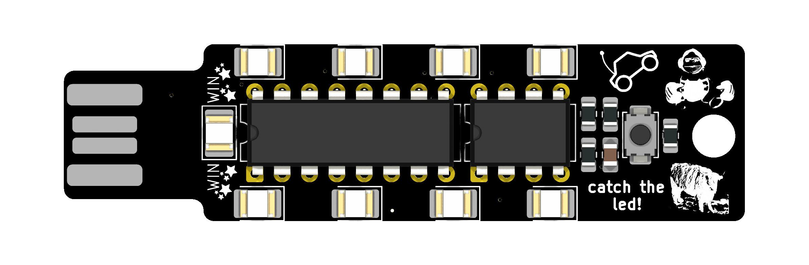
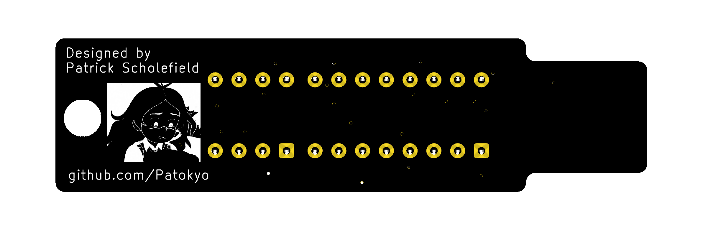
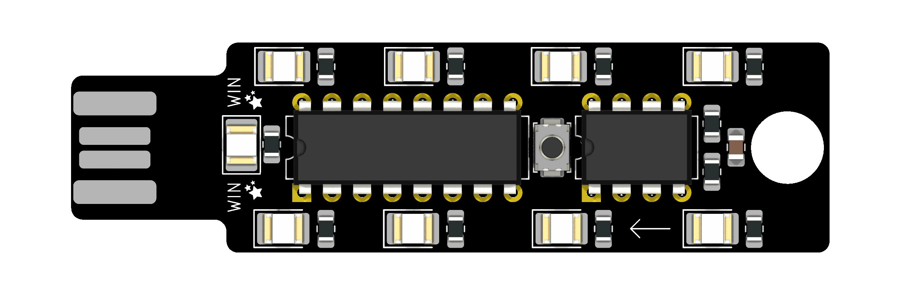
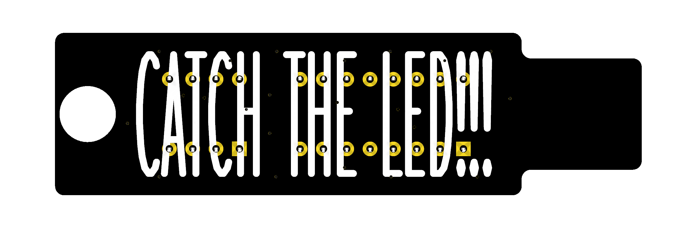

# catch the LED!

A tiny, USB-stick-shaped LED roulette. Nine LEDs chase around the loop and a push
button freezes the chase — whatever LED is lit when you press it is the one you
"caught".

The whole board is a USB-A plug: the tongue of the PCB *is* the connector, so it
plugs straight into any USB port for power. No cable, no adapter, no firmware.

<p align="center">
  
</p>
<p align="center"><sub><b>Front</b> — nine 1210 LEDs, the 555 and 4017 as DIP-8 / DIP-16, and the USB-A PCB tongue on the left · black solder mask</sub></p>

<p align="center">
  
</p>
<p align="center"><sub><b>Back</b> — artwork, credits and the 4 mm mounting hole</sub></p>

## How it works

```
        ┌──────────┐   clock    ┌────────────┐   Q0…Q8    ┌──────────────┐
  USB ──┤ NE555P   ├───────────►│ CD4017     ├───────────►│ D1 … D9      │
  5 V   │ astable  │            │ decade     │            │ 1210 LEDs    │
        └──────────┘            │ counter    │            └──────┬───────┘
                                └─────┬──────┘                   │
                                      │ Q9 → Reset               │
                            SW1 ──────┴─ CKEN           R4 330Ω ──┴── GND
                       (press = freeze the chase)
```

1. **U1 (NE555P)** runs as an astable oscillator at roughly 20 Hz, set by
   R1 4k7, R2 1k and C1 10 µF.
2. **U2 (CD4017)** counts those pulses and walks one output high at a time.
   Q0…Q8 each drive one LED anode and the nine cathodes share R4 (330 Ω) to
   ground; Q9 is wired back to `Reset` so the counter rolls over after nine
   steps.
3. **SW1** pulls `CKEN` (clock enable) high, which stops the counter — the lit
   LED stays lit. R3 10k holds `CKEN` low so the chase runs by default.

## Board

| | |
|---|---|
| Size | 63.35 × 16.61 mm (2.49 × 0.65 in), USB-A plug included |
| Stack-up | 2 copper layers, 1.6 mm FR4 |
| Power | 5 V from USB-A, power only — D+ / D− are not connected |
| Current | ≈ 9 mA per lit LED (5 V − V<sub>f</sub>) / 330 Ω |
| Mounting | 4 mm hole at the far end |

## Bill of materials (catch-the-led)

| Ref | Value | Footprint |
|---|---|---|
| U1 | NE555P timer | DIP-8, 7.62 mm |
| U2 | CD4017 decade counter | DIP-16, 7.62 mm |
| D1–D9 | LEDs | 1210 / 3225 metric |
| R1 | 4k7 | 0805 |
| R2 | 1k | 0805 |
| R3 | 10k | 0805 |
| R4 | 330 | 0805 |
| C1 | 10 µF | 0805 |
| SW1 | Tactile push button, TS-1088 | SMD 4.5 × 4.5 mm |
| U3 | USB-A plug | PCB edge connector (no part to fit) |

Every placed part carries a STEP model reference from the official KiCad
library (`${KICAD9_3DMODEL_DIR}`), so the 3D viewer is complete. The USB
connector is deliberately model-less: it is bare board, not a purchased part.

## Repository layout

```
catch-the-led/                 final board (v2)
  catch-the-led.kicad_pro/-sch/-pcb
  catch-the-led-*.gbr, *.drl   fabrication output
proto-1/                       first prototype of the same circuit
  proto-1.kicad_pro/           project directory (note the nested folder)
usb-ic/                        placeholder project, no schematic yet
images/                        renders used in this README
catch-the-led_gerber.zip       packed gerbers, ready for a fab house
```

Both boards share the same 555 + 4017 core. `proto-1` is the earlier
hand-soldered take: one 330 Ω resistor per LED instead of a shared one, the
button on a different node, roomier pads, and no reference designators on the
silkscreen. `catch-the-led` is the finished version.

<p align="center">
  
</p>
<p align="center">
  
</p>
<p align="center"><sub><b>proto-1</b> — the prototype: same 555 + 4017 core, one resistor per LED and a big silk title on the back</sub></p>

## Opening and fabricating

1. Open `catch-the-led/catch-the-led.kicad_pro` in **KiCad 9** — that project
   is in the current format. `proto-1` is still in the KiCad 6 format and
   opens fine, but KiCad will offer to update it on save.
2. Gerbers and drills are already generated in the project folder, or use
   `catch-the-led_gerber.zip` at the repo root.
3. The USB-A tongue is bare board, so it has to be thin enough to slide into
   a port — worth mentioning to the fab when ordering.

Renders above come from KiCad's 3D raytracer (`kicad-cli pcb render`, KiCad
10) with the solder mask set to black in the board stackup.

## Credits

Designed by **Patrick Scholefield** — [github.com/Patokyo](https://github.com/Patokyo).
Silkscreen and copper artwork is hand-drawn on the boards themselves.
